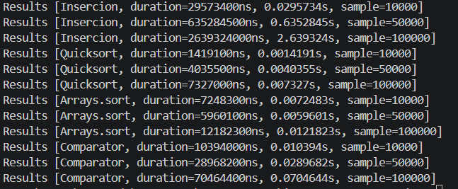

# Práctica de Laboratorio: Comparativa de Algoritmos de Ordenamiento

* **Autora:** Fernanda Cueva Maldonado
* **Asignatura:** Estructura de Datos
* **Repositorio:** `icc-est-u1-comparativa`
* **Investigación del algoritmo V2:** Ver [INVESTIGACION.md](INVESTIGACION.md)

---

## 1. Objetivo

Implementar, integrar y comparar el rendimiento temporal de cuatro variantes de ordenamiento ascendente en Java sobre arreglos de enteros de tres tamaños distintos (`10.000`, `50.000` y `100.000` elementos), midiendo exclusivamente el tiempo de ejecución de cada algoritmo mediante una utilidad de *benchmarking*.

---

## 2. Métodos seleccionados

| ID | Variante | Implementación en el proyecto | Datos y criterio |
| :--- | :--- | :--- | :--- |
| **V1** | Método básico | **Ordenamiento por Inserción** (`ordenarInsercion`) | `int[]`, orden ascendente |
| **V2** | Método investigado | **Quick Sort** con partición de Lomuto (`ordenarQuickSort`) | `int[]`, orden ascendente |
| **V3** | Biblioteca estándar | **`Arrays.sort(int[])`** (`ordenarArraysSort`) | `int[]`, orden ascendente |
| **V4** | Biblioteca con comparador | **`Arrays.sort` con `Comparator<Integer>`** (`ordenarComparatorLambda`) | Conversión a `Integer[]`, comparación segura con `Integer.compare(a, b)` |

---

## 3. Entorno, compilación y ejecución

* **Sistema operativo:** Windows
* **IDE / Editor:** Visual Studio Code
* **Lenguaje:** Java (JDK 21.0.12)

### Comandos desde la raíz del proyecto

Compilar todas las clases en la carpeta `bin`:
```bash
javac -d bin src/*.java
```

Ejecutar la aplicación principal:
```bash
java -cp bin App
```

---

## 4. Estructura del proyecto y responsabilidades

```text
icc-u1-est-comparativa/
├── assets/
│   └── salidadeconsola.png   # Captura de pantalla de la consola
├── bin/                      # Archivos compilados (.class)
├── evidencias/
│   └── pruebas.md            # Casos de aceptación y salidas reales
├── lib/                      # Dependencias externas (si aplica)
├── src/
│   ├── App.java              # Control de experimentos, punto de entrada y reporte
│   ├── Benchmark.java        # Medición de tiempos de ejecución
│   ├── Generado.java         # Generación de arreglos aleatorios base
│   ├── Metodos.java          # Implementación de las 4 variantes de ordenamiento
│   └── Results.java          # Modelo de datos para almacenar y formatear resultados
├── investigacion.md          # Investigación técnica de V2 (Quick Sort)
└── README.md                 # Documentación general del proyecto
```

### Responsabilidades y flujo de datos entre clases
1. **`Generado` (`src/Generado.java`):** Construye una única muestra aleatoria de enteros (`int[]`) por cada tamaño solicitado (`10.000`, `50.000` y `100.000`).
2. **`App` (`src/App.java`):** Coordina los experimentos. Solicita los 3 arreglos base a `Generado`, crea copias independientes (`.clone()`) para cada variante, envía cada ordenamiento a `Benchmark.medir(...)`, guarda los 12 objetos `Results` en una `List<Results>` y al final imprime la lista completa en consola.
3. **`Metodos` (`src/Metodos.java`):** Contiene la lógica de ordenamiento de V1 (Inserción), V2 (Quick Sort), V3 (`Arrays.sort`) y V4 (`Arrays.sort` con `Comparator`).
4. **`Benchmark` (`src/Benchmark.java`):** Recibe la operación a medir, ejecuta el cronómetro y construye el objeto `Results` con la duración medida.
5. **`Results` (`src/Results.java`):** Almacena el nombre del método, el tamaño de la muestra (`sample`) y la duración en nanosegundos, sobrescribiendo `toString()` para mostrar el tiempo tanto en nanosegundos como en segundos.

---

## 5. Explicación del benchmarking

* **Interfaz funcional y lambdas:** `Benchmark.medir(...)` recibe la operación de ordenamiento mediante una interfaz funcional (`Runnable`), lo que permite pasar cada llamada desde `App.java` usando expresiones lambda como `() -> m.ordenarQuickSort(lista1c2)` sin ejecutar el método antes de encender el cronómetro.
* **Inicio, fin y unidades:** El tiempo se toma con `System.nanoTime()` justo antes de invocar `run()` y justo después de terminar. La diferencia se guarda en nanosegundos (`long`) dentro de `Results` y se convierte a segundos (`double`) dividiendo para `1_000_000_000.0` (y a milisegundos dividiendo para `1_000_000.0` para el reporte en tabla).
* **Significado de `sample`:** Identifica el tamaño del arreglo de entrada evaluado en esa corrida (`10000`, `50000` o `100000`).
* **Tratamiento de errores:** Las pruebas se ejecutaron sobre copias válidas y no nulas; en `Metodos.java` se validan casos base (como arreglos nulos o de longitud menor a 2 en Quick Sort) para evitar fallos en tiempo de ejecución.
* **Operaciones excluidas del cronómetro:** Tanto la generación de los 3 arreglos aleatorios (`g.generate(...)`) como la creación de los 12 clones (`.clone()`) y la impresión por consola (`System.out.println`) se realizan **fuera** del bloque medido por `Benchmark.medir`.
* **Almacenamiento e impresión final:** Cada llamada retorna un objeto `Results` que se añade a `List<Results> resultados = new ArrayList<>();`. Solo cuando concluyen las 12 mediciones se recorre la lista con un `for-each` para imprimir todos los resultados juntos.

---

## 6. Procedimiento y resultados

### Orden y condiciones de ejecución
1. Se genera una sola muestra aleatoria por tamaño: `list1` (`10.000`), `list2` (`50.000`) y `list3` (`100.000`).
2. Se crean 4 clones independientes por cada tamaño (`c1`, `c2`, `c3`, `c4`) para garantizar que las cuatro variantes ordenen exactamente los mismos datos desordenados.
3. Se ejecutan las mediciones agrupadas por método en el siguiente orden: **Inserción (V1)** → **Quick Sort (V2)** → **Arrays.sort (V3)** → **Comparator (V4)**, evaluando en cada uno `10.000`, `50.000` y `100.000` elementos.

### Captura de salida en consola


### Tabla de resultados (12 mediciones)

| Método | Sample | Tiempo (ms) |
| :--- | :---: | :---: |
| Inserción | 10.000 | 29.5734 ms |
| Inserción | 50.000 | 635.2845 ms |
| Inserción | 100.000 | 2639.3240 ms |
| Quicksort | 10.000 | 1.4191 ms |
| Quicksort | 50.000 | 4.0355 ms |
| Quicksort | 100.000 | 7.3270 ms |
| Arrays.sort | 10.000 | 7.2483 ms |
| Arrays.sort | 50.000 | 5.9601 ms |
| Arrays.sort | 100.000 | 12.1823 ms |
| Comparator | 10.000 | 10.3940 ms |
| Comparator | 50.000 | 28.9682 ms |
| Comparator | 100.000 | 70.4644 ms |

*(Nota: los tiempos corresponden a una ejecución concreta en el equipo utilizado; una sola corrida por método y tamaño no permite afirmar que un algoritmo será siempre más rápido en todos los escenarios).*

---

## 7. Evidencias

* Captura de la ejecución completa: 
* Casos de aceptación y salidas reales: [text](evidencias)

---

## 8. Conclusiones

1. Al comparar el método básico con el investigado se nota enseguida el impacto de la complejidad: mientras **Inserción** pasó de `29.5734 ms` con 10.000 datos a `2639.3240 ms` con 100.000 (más de dos segundos y medio), **Quicksort** solo subió de `1.4191 ms` a `7.3270 ms`. En arreglos grandes, la diferencia entre un algoritmo $O(n^2)$ y uno $O(n \log n)$ deja de ser teórica y se vuelve muy evidente en el tiempo real de espera.
2. En esta ejecución llama la atención que **`Arrays.sort`** tardara `7.2483 ms` en 10.000 elementos, un tiempo incluso mayor que los `5.9601 ms` que marcó en 50.000, y que terminara en `12.1823 ms` para 100.000 frente a los `7.3270 ms` de Quicksort. Esto refleja cómo influye el calentamiento inicial de la JVM y del compilador JIT en las primeras llamadas, confirmando que una sola medición aislada no basta para asegurar que un algoritmo ganará siempre.
3. Entre las variantes rápidas, **`Comparator`** fue la más costosa en todos los tamaños, escalando de `10.3940 ms` en 10.000 datos hasta `70.4644 ms` en 100.000 (casi diez veces más que Quicksort). Esto demuestra que convertir primitivos `int[]` a objetos `Integer[]` y evaluar un comparador en cada paso introduce una carga extra importante en memoria y tiempo frente a ordenar primitivos directamente.