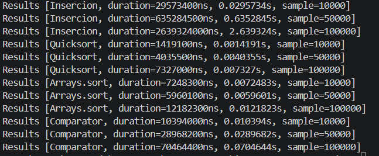

# Evidencias: Casos de Aceptación y Salidas Reales

## 1. Casos de aceptación verificados

| ID | Caso de aceptación | Qué se verificó | Resultado |
| :--- | :--- | :--- | :---: |
| **CA-01** | Compilación limpia del proyecto | Compilación de todas las clases en `src/` hacia `bin/` sin errores de sintaxis ni dependencias faltantes (`javac -d bin src/*.java`). | Aprobado |
| **CA-02** | Generación única por tamaño e independencia de datos | Se genera una sola muestra aleatoria para `10.000`, `50.000` y `100.000` elementos y se crean 4 copias independientes (`.clone()`) por tamaño antes de medir, evitando que un método ordene un arreglo ya ordenado por otro. | Aprobado |
| **CA-03** | Ejecución completa de las 12 mediciones | `App.java` ejecuta las 4 variantes (**Inserción**, **Quicksort**, **Arrays.sort** y **Comparator**) sobre los 3 tamaños de muestra y almacena los 12 objetos `Results` en una lista. | Aprobado |
| **CA-04** | Exclusión de operaciones ajenas al cronómetro | La generación de arreglos, el clonado y la impresión en consola ocurren fuera de `Benchmark.medir(...)`; solo se cronometra la lambda de ordenamiento. | Aprobado |
| **CA-05** | Formato de salida y tiempos válidos | La consola imprime las 12 líneas al finalizar las pruebas mostrando nombre del método, duración en nanosegundos, duración en segundos (`double`, sin truncamiento a cero) y `sample`. | Aprobado |
| **CA-06** | Coherencia de resultados y manejo de casos borde | Los métodos de `Metodos.java` ordenan de forma ascendente (validado en traza manual de `[7, 2, 7, 0, 4, 2]` → `[0, 2, 2, 4, 7, 7]` y con validación de arreglos nulos o de longitud `< 2` en Quick Sort). | Aprobado |

---

## 2. Salida real de consola



Comando ejecutado desde la raíz del repositorio:
```bash
java -cp bin App